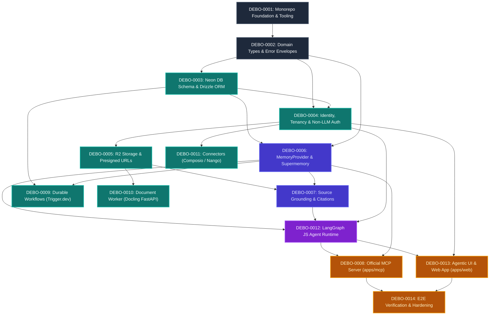

# Debo Implementation Dependency Graph

This document details the topological dependency graph across all system modules, packages, and services. Work cannot advance to a downstream layer until upstream contracts and baseline implementations are verified.

---

## Topological Execution Waves

### Wave 1: Repository Foundation (Phase 1)
- **`DEBO-0001`**: Monorepo scaffolding, Bun workspaces, Turborepo, shared tsconfig, Biome linting.
- **`DEBO-0002`**: Domain primitives, error types, result envelopes, zero-dependency contract types.

### Wave 2: Persistence & Authorization (Phase 2 & 3)
- **`DEBO-0003`**: PostgreSQL Drizzle schema, 24 normalized entities, tenant foreign keys, migration generator.
- **`DEBO-0004`**: Deterministic auth resolver, session verification, workspace context, Non-LLM Authority invariant.
- **`DEBO-0005`**: Cloudflare R2 object storage client, SigV4 presigned upload/download URLs.

### Wave 3: Memory Subsystem & Provenance (Phase 4)
- **`DEBO-0006`**: `MemoryProvider` contract, Supermemory SDK adapter, semantic recall, fallback degraded mode.
- **`DEBO-0007`**: Source grounding verifier, character span validation, bounding box mapping, anti-hallucination guard.

### Wave 4: Processing Workers & Connectors (Phase 7, 8, 12)
- **`DEBO-0009`**: Trigger.dev v3 background task pipelines, retries, cron schedules.
- **`DEBO-0010`**: Python Docling worker, layout OCR, table extraction, HTTP service.
- **`DEBO-0011`**: Composio tool actions, Nango continuous OAuth sync, encrypted credentials vault.

### Wave 5: Agent Intelligence Core (Phase 5)
- **`DEBO-0012`**: LangGraph JS cyclic state graph engine, tool permission pipeline, human approval interrupts.

### Wave 6: Presentation & External Gateways (Phase 6, 9)
- **`DEBO-0008`**: Official MCP server (`apps/mcp`), Streamable HTTP & stdio transports, tool taxonomy.
- **`DEBO-0013`**: Next.js App Router web application (`apps/web`), AG-UI streaming protocol, calm editorial Radix/Tailwind components.

### Wave 7: Verification & Hardening (Phase 16)
- **`DEBO-0014`**: Full-system E2E test suite, memory evaluation benchmarks, security penetration checks, Cloudflare Tunnel verification.
